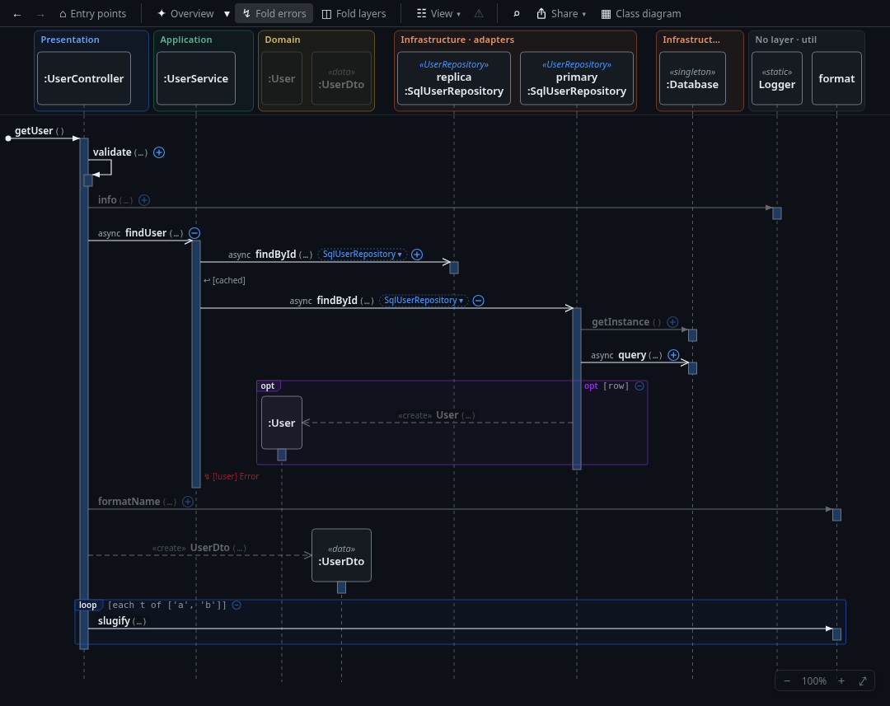
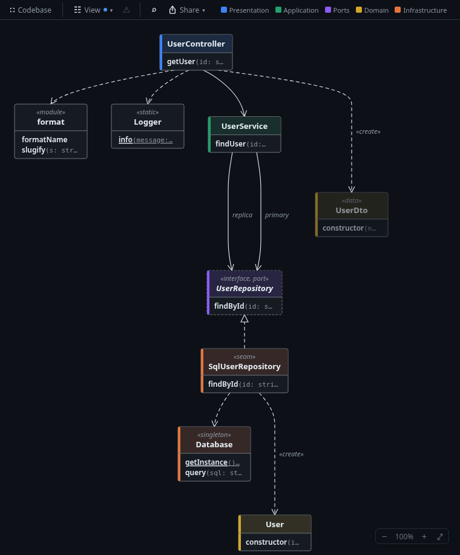

# Seqcall

Seqcall draws **interactive UML sequence diagrams** from TypeScript/JavaScript, C# and PHP code, plus a **live
class diagram** of the classes in the visible interaction. It is made for navigating a codebase and understanding
its dynamic behaviour: it shows little by default, adds detail when you ask, and every element links back to the
code. It runs in VS Code (and Cursor, VSCodium, Windsurf), JetBrains IDEs (Rider, PhpStorm) and Vim / Neovim
(diagrams in a browser tab); a CLI and MCP server give AI coding agents the same analysis.





- Why it exists: [docs/VISION.md](docs/VISION.md)
- What it does, in detail: [docs/FUNCTIONAL-REQUIREMENTS.md](docs/FUNCTIONAL-REQUIREMENTS.md) (the FR ids below)
- How it is built: [docs/ARCHITECTURE.md](docs/ARCHITECTURE.md)

## Install

Download the package for your editor from the GitHub **Releases** page and follow [docs/INSTALL.md](docs/INSTALL.md)
(packages, requirements per editor and language, updates). In short: VS Code 1.90+ needs nothing else; JetBrains IDEs
2026.2+ and Vim 9 / Neovim 0.10+ need Node.js 20+; C# projects need the .NET 10 runtime.

## Getting started

| Editor | Sequence diagram of the method at the cursor | Also |
|---|---|---|
| VS Code | **Ctrl+Alt+U** or right-click → **Show Sequence Diagram** | the **Seqcall** activity-bar icon: Entry Points, Design Issues, Review; *Seqcall: …* commands |
| JetBrains | **Ctrl+Alt+Shift+K** or right-click → **Show Sequence Diagram** | **Tools → Show Class Diagram**; right-click → **Seqcall: Info at Caret** ([docs/RIDER-PLUGIN.md](docs/RIDER-PLUGIN.md)) |
| Vim / Neovim | `:SeqcallShow` (editor started in the project directory) | `:SeqcallEntryPoints`, `:SeqcallClass`, `:SeqcallInfo`, `:help seqcall` ([docs/VIM-PLUGIN.md](docs/VIM-PLUGIN.md)) |

No method in mind? Open **⌂ Entry points**: HTTP routes, pages, `main`, jobs, handlers and tests, searchable; pick
one to see its flow. On a real project, start at a use case (a controller method, a CLI command, an application
service), expand step by step, choose implementations for interfaces and hide noise such as logging.

The project root is the nearest `tsconfig.json` / `jsconfig.json` (TS/JS), `composer.json` (PHP) or solution
(`.sln` / `.slnx`, else `.csproj`) (C#). The first diagram waits while the project loads; later ones are fast.
Saving a file refreshes the diagram and keeps what you expanded; hidden calls, options and dragged positions are
saved per workspace.

## Feature tour

Try these on `fixtures/sample-app` from this repository (or on your own code).

### Open and navigate a flow

| Try | Expect | FR |
|---|---|---|
| ⌂ **Entry points** (toolbar, empty panel, command *Show Entry Points*) | Where flows start, grouped by project and kind (routes as verb + path → `Class.method`, React pages and UI roots, programs, jobs, handlers, tests); type to filter, also by method name (*Methods*); pick one → its diagram, first arrow tagged with the route | 16.1, 16.2, 16.6, 16.7, 16.12, 16.15 |
| VS Code: the **Seqcall** activity-bar icon | The Entry Points sidebar (*Load Entry Points* the first time; *Go to Entry Point…* searches all projects); ⋯ → *Select Entry Points for a Map* | 16.4, 26.8 |
| Cursor in `UserController.getUser`, Ctrl+Alt+U | Found message `getUser`, direct calls only; participants in Presentation / Application / Domain bands | 1.1, 1.3, 6.4 |
| Click a message / its activation bar / an object box | The editor jumps to the call / the executed method / the declaration (outlined in the class diagram too) | 2.1, 2.5, 12.17 |
| Click a call, then **↓ ↑ → ←**; hover a call, click the receiver's name | Walk the calls (Enter opens the code, Space / + / − expand / collapse); scroll sideways to the receiver, **Backspace** back | 9.7, 9.9 |
| Right-click `findUser` → *Show callers* | Callers in `UserController` and `AdminController`; pick one to re-root there, ← back | 4.1–4.3 |
| Right-click `SqlUserRepository.findById` → *Paths to here…* | All callers up to the entry points (through the interface); a row opens that path expanded to the method; **Copy as Markdown** | 22.1–22.4 |
| Ctrl+F (or `/`, ⌕), type `query` | Drawn matches outlined; matches inside collapsed calls listed, a click opens only that path; camelCase initials (`fU`); `@Name` marks an object's messages | 23.1–23.3 |
| Shift+click a lifeline (or right-click → *Find its messages*) | Its messages marked; Enter / Shift+Enter step through them | 23.5 |
| View ▾ → **Follow cursor**, click into another method | The diagram redraws for that method | 1.7 |
| View ▾ → **How to read this…**; press **?** | What each mark means; every key | 14.7, 14.8 |

### Choose the level of detail

| Try | Expect | FR |
|---|---|---|
| ⊕ / ⊖ next to `findUser` | Its calls appear / fold; two `UserRepository` fields show as `primary:` / `replica:` | 3.1, 6.2 |
| ✦ **Overview** | Opens the important calls of the main path (layer crossings, services, ports, I/O); logging and mapping stay collapsed and dimmed; hover a message for the reasons; stops at a budget with **Continue** | 3.6, 3.9, 3.10 |
| ✦ ▾ **Expand all** / **Changes**; Shift+click ⊕ | Every call (during a review: the paths to the changes) / everything below one call | 3.3, 3.7, 3.12 |
| **↯ Fold errors** (on by default) | Catch blocks, guard clauses and error branches fold into one-line markers (`↯ [!valid] ValidationException ⊕ 2 calls`); ⊕ shows one | 3.11, 3.12 |
| `choose impl` badge on `findById` | Pick `SqlUserRepository`; the call becomes expandable; *Back to interface* reverts. With DI registrations (Laravel providers, C# `services.Add…`) the bound implementation is chosen and marked *bound · file:line* | 8.1–8.3, 8.8 |
| Right-click `info` → *Hide all calls to info*; *Don't expand calls to …* | Hidden (or kept with ⊡, skipped by Overview / Expand all); **Filters ▾** lists the rules; hiding applies to both diagrams | 11.1–11.3, 11.7 |
| Right-click a lifeline → **Hide every…** (*Classes named \*Repository*, *Every «data» class*) | All such classes leave both diagrams in one step | 11.8, 7.15 |
| ◫ **Fold layers** | One lifeline per layer, only layer-crossing calls drawn (+n for the folded ones); ⊕ on a layer opens it in place, ⊖ on a band folds one layer; right-click a layer to pull one object out | 28.1, 28.11 |
| Right-click the guard of an `alt` branch → **Follow this case** | Only that case stays (`📌 2 other cases` brings the rest back) | 1.22 |
| ⊖ after a fragment's guard | `loop [each user of users] ⋯ 4 calls ⊕`; its calls leave both diagrams until restored | 1.12 |
| View ▾ → Arguments, Results, Return types, Library calls, I/O badges, Fragments, Pipeline, One lifeline per helper type | Each off/on; a dot on View ▾ marks options that differ from the defaults | 9.3–9.6, 1.6, 14.2, 5.13 |
| Drag a participant box | Reordered, then packed again (View ▾ → *Tidy up after expanding* off: stays where dropped; *Tidy up now*) | 10.1–10.3 |
| Ctrl + wheel / − 100% + ⤢ | Zoom (⤢ = fit) | 14.5 |

### Read the flow

| Try | Expect | FR |
|---|---|---|
| `ImportService.importAll` | `loop`, `alt`, `opt` and `try [catch]` frames; click a tag or guard → the condition in the editor | 1.10, 1.12 |
| `UserService.findUser` | `↩ [cached]` early return, `↯ [!user] Error` throw on the activation bar | 1.15 |
| A `try` | Each catch says what it does: `logged, swallowed` (amber), `↩ null`, `skipped` | 1.17 |
| `«create» UserDto(…)` | Dashed arrow to a box at the row of creation | 5.1, 5.2 |
| Hover a message | Who calls whom, the return type, importance reasons, I/O evidence | 9.4–9.8 |
| **I/O** pills `DB` `CACHE` `HTTP` `FILE` `MQ` `CLOUD` `PROC` | The call's method does I/O (by the libraries it calls); dashed = further down, found by a background scan | 17.1 |
| A singleton / scoped service reached through several fields | One lifeline, not one per field | 6.7 |
| An entry point with a DI container or route middleware | A collapsed `resolve(X::class)` / **● through …** row before the action: what runs first | 8.7, 18.14 |

### Class diagram

| Try | Expect | FR |
|---|---|---|
| **Class diagram**, then expand / collapse in the sequence view | Second panel with the visible classes, updated live; coloured by layer, one lane per layer (View ▾ → ☰ Layers) | 12.1–12.4, 12.7 |
| Click a method / a relation | Jump to it; its calls highlighted in the sequence diagram (expanded until they appear) | 12.9, 12.13, 12.14 |
| `ShippingService.ship`, Expand all, **⇢ Uses** | Dotted «use» edges for referenced types; `ShippingPolicy` → `shipping-config` red (Domain → Infrastructure) | 12.12 |
| ⛶ **Codebase** | The classes every entry point reaches, as folders / packages with counted relations and layer violations; click a package to open it | 26.1 |

### Layers, design issues, review

| Try | Expect | FR |
|---|---|---|
| Right-click a box → *Why this layer and these stereotypes?* | The rule that placed it, where each stereotype comes from, its layer violations, *Move to layer…* | 7.8, 7.9 |
| A ⚑ on a box | Layer hint: the code suggests another layer; click to add a rule to `.seqcall.json` (this file, its folder or a name pattern; Undo offered) or *Ignore this hint* | 7.4 |
| **⚠ N** (toolbar, class legend) | Design issues in the flow: I/O in a loop (N+1), I/O in Domain, layer ping-pong, cyclic collaboration, dependency cycles, god classes, too many dependencies; a card says why, how to fix, **Ignore**, **Copy as Markdown** | 19.1, 19.11, 19.21 |
| ⌂ → **⚠ Design issues** (VS Code sidebar: *Scan for Design Issues*) | The whole project scanned on request, findings listed with their flows | 19.9, 19.12 |
| ∅ **Unreachable** | Methods no entry point reaches, by reason (no callers, only tests, maybe called, probably called by the framework) | 31.1 |
| ⌂ → **⎇ Review changes** (VS Code: *Review Branch*, *Compare with…*) | The branch against its base: structural delta (layer dependencies, violations, entry points, I/O, cycles), changed methods and the entry points they affect; diagrams mark new (green), changed (amber) and removed (red dashed) calls; **N / P** walk the changes with their diff; **Copy as Markdown** | 24.1, 24.3, 24.9, 29.1 |
| A review in the class diagram | Changed classes marked **NEW** / **Δn**, **P / N** step through them | 24.16 |

### Share

| Try | Expect | FR |
|---|---|---|
| Share → *Copy as image (PNG)* / *Save as PNG… / SVG…* | The diagram in your theme's colours | 25.1 |
| Share → *Copy as text* | The flow as an indented tree with `file:line`, for an AI chat or a note | 25.4 |
| Right-click a call → *Ask AI about this call* | A ready question with the flow on the clipboard | 25.5 |
| Share → *Copy / Save to reopen elsewhere*; *Open a shared diagram…* | JSON with root, expansions, choices, options and commit; the receiver sees the same diagram and a notice of what differs | 25.2 |
| In that notice: *Use the sender's layer config* | Their `.seqcall.json`, in memory only, until *Back to my config* | 25.3 |

### Editor extras (VS Code)

- **Hover** on a call through an interface: which implementation runs and its I/O; on a method name: the entry
  points that reach it (setting `seqcall.hover`).
- *Seqcall: Show Memory* / *Free Memory*.
- Updates itself from the GitHub releases (`seqcall.autoUpdate`, *Seqcall: Check for Updates*); see
  [docs/INSTALL.md](docs/INSTALL.md).

## Languages

**TypeScript / JavaScript** run in-process. Lambdas given to library functions are drawn where they run
(`users.map(u => …)` inside `loop [each u of users]`); a lambda passed to your own function is shown where that
function calls it (`ƒ action ⊕`). React components used in JSX are messages (`«render» DashboardTab(…)`), with
`{open && …}` as `opt` and `items.map(…)` as `loop`.

**C#** runs in a Roslyn sidecar process (`[C#]` lines in the log). Like any C# IDE, loading the solution runs
MSBuild design-time builds, which may update `obj/` folders. Layers also come from dotted project names (`App.Web`,
`App.Core`, `App.Infrastructure`). Immutable objects (records, `readonly` classes) share one lifeline per class
(`×n`). Protocol: [docs/CSHARP-SIDECAR.md](docs/CSHARP-SIDECAR.md).

**PHP** (Laravel and plain PHP 8) runs in-process without PHP or `vendor/`. Types come from declarations (typed
parameters and properties, return types, PHPDoc, `new`, `catch`, a few Laravel helpers); untyped code and runtime
magic (`__call`, container lookups by string) stay unresolved. Classes the project does not declare are libraries,
so facades such as `DB::` still get I/O badges. With `vendor/` installed, library return types are used and your own
Composer packages (same vendor as the project) are followed like project code. Entry points: routes with full
paths (also those your packages register), Artisan commands, queued jobs, event listeners, PHPUnit tests; a route's
diagram starts with its middleware (**● through …**).

## Configuration

Settings live in **`.seqcall.json`** at the project root (comments allowed); everything is optional. Seqcall edits it
itself when you *Move to layer*, *Ignore* a finding or hint (comments and formatting kept, Undo offered).
Example: [fixtures/sample-app/.seqcall.json](fixtures/sample-app/.seqcall.json).

```jsonc
{
  "layers": [{ "name": "Presentation", "match": ["src/controllers/**"] }],   // first match wins
  "layerOrder": ["Presentation", "Application", "Ports", "Domain", "Infrastructure"],
  "preset": "laravel",                 // or "fsd", "none"; detected when absent
  "stereotypes": [{ "stereotype": "gateway", "match": { "name": ".*Gateway$" } }],  // match: name, path, decorator, implements
  "disableBuiltinStereotypes": false,
  "dependencyRule": { "Domain": 0, "Application": 1, "Ports": 1, "Presentation": 2, "Infrastructure": 2 },
  "associationNames": "non-obvious",   // or "all"
  "testFiles": ["e2e/**"],             // replaces the default test globs
  "smartExpand": { "budget": 60, "important": ["*.charge"], "unimportant": ["*Mapper.*"] },
  "findings": { "maxDependencies": 6, "disable": ["layer-ping-pong"], "ignore": ["*Cache*"],
                "godClass": { "methods": 20, "lines": 500, "fields": 10, "dependencies": 7, "models": false } },
  "layerHints": { "ignore": ["src/legacy/**"] },
  "unreachable": { "ignore": ["database/migrations/**", "*Middleware.handle"] },
  "packages": ["acme/*"],              // PHP: Composer packages analysed as project code
  "pipeline": { "route": true, "controller": true, "global": false }      // PHP: middleware before the action
}
```

**Layers and stereotypes** are inferred from folder names (`controllers`, `services`, `domain`, `adapters`, …),
names, decorators / attributes and the code itself; *Why this layer?* shows which rule decided. The **Laravel** and
**Feature-Sliced Design** presets are detected from the project (FR-7.11).

**The dependency rule** gives each layer a ring, 0 innermost; depending on an outer ring is a layer violation (red
in both diagrams; amber, *possible*, when a layer is only guessed). The defaults are Clean / hexagonal architecture
(above); the FSD preset uses FSD's import order. Your `dependencyRule` replaces them; layers without a ring are not
checked.

**Editor settings** (VS Code `seqcall.*`, JetBrains Settings → Tools → Seqcall, Vim `:help seqcall`) hold the view
defaults: arguments, results, library calls, I/O badges and background scan, fragments, pipeline, hover, class
diagram methods per class (`seqcall.classDiagram.maxMethods`), automatic updates.

## AI agents and scripts

The `seqcall` CLI answers the same questions as text (few tokens) or JSON (`--format json`); `seqcall mcp` serves
them as MCP tools and keeps the project loaded between calls. Install: [docs/INSTALL.md](docs/INSTALL.md#ai-coding-agents-claude-code-other-mcp-clients-the-cli).

```sh
seqcall flow   src/controllers/user-controller.ts:12   # what a method does: I/O, loops, issues (--tree: every call)
seqcall paths  app/Services/TaxService.php:66          # who reaches it, up to the entry points
seqcall review --base main                             # the branch's structural delta, changed methods, new issues
seqcall entrypoints post orders                        # entry points, filtered by words
seqcall outcomes --detail                              # what each entry point touches (DB / HTTP / files / queues)
seqcall impls  src/Payments/PaymentGateway.php:7       # implementations of an interface method, what DI gives
seqcall issues                                         # design issues of the project, by flow
seqcall unreachable                                    # methods no entry point reaches, by reason
```

Lines are 1-based, any line of the method. A line starting with `# INCOMPLETE` names a limit that cut the result.

## Development

```sh
git clone git@github.com:seqcall/seqcall.git && cd seqcall
nvm use
npm install && npm run build
npm test
npm run dev:host -- <project>   # a VS Code Extension Development Host on a project
```

- [CONTRIBUTING.md](CONTRIBUTING.md): issues, pull requests, what a change brings along.
- [AGENTS.md](AGENTS.md): repository layout, all build / package / release commands, conventions.
- [docs/TESTING.md](docs/TESTING.md): test suites, visual checks with the browser dev host, smoke tests, debugging.
- [docs/ARCHITECTURE.md](docs/ARCHITECTURE.md): architecture and design decisions;
  [docs/RIDER-PLUGIN.md](docs/RIDER-PLUGIN.md), [docs/VIM-PLUGIN.md](docs/VIM-PLUGIN.md),
  [docs/CSHARP-SIDECAR.md](docs/CSHARP-SIDECAR.md): the hosts and the C# sidecar.

The class diagram is laid out with [ELK](https://eclipse.dev/elk/) (`elkjs`, EPL-2.0), with dagre (MIT) as fallback.

## License

Copyright 2026 Dimitris Dranidis. Licensed under the [Apache License 2.0](LICENSE).
