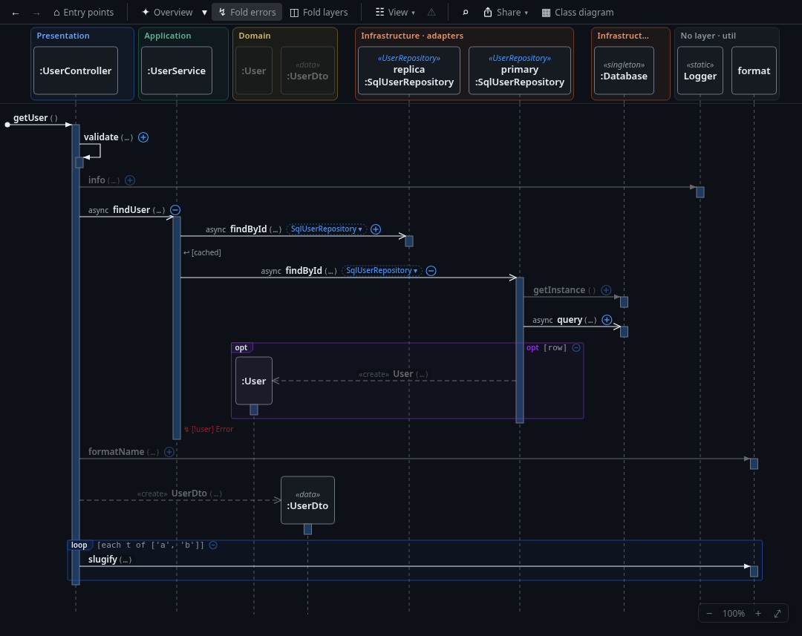

The first public release of Seqcall: interactive UML sequence diagrams and a live class diagram, drawn from your
code, to understand what a request, a job or a command really does.

**Editors:** VS Code (and Cursor, VSCodium, Windsurf), JetBrains IDEs 2026.2+ (Rider, PhpStorm, …), Vim 9 and
Neovim (diagrams in a browser tab). **AI agents:** a CLI and an MCP server with a Claude Code plugin.
**Languages:** TypeScript / JavaScript, C# (Roslyn) and PHP (Laravel and plain PHP 8).

What it does:

- **Start anywhere:** from the method under the cursor, or from the entry points it finds (routes, programs, jobs,
  handlers, tests).
- **Choose the level of detail:** expand calls one by one, let ✦ Overview open the main path, fold error handling,
  fold whole layers into one lifeline each, hide what you do not care about.
- **Read the flow:** `loop` / `alt` / `opt` / `try` frames, early returns and throws, object creation, I/O badges
  (DB, HTTP, cache, files, queues), the implementation an interface call reaches (from DI registrations when there are
  any).
- **Class diagram:** the classes of the visible interaction, updated live, coloured by layer or one lane per
  layer; a codebase map of what every entry point reaches.
- **Architecture checks:** layers and stereotypes from conventions or `.seqcall.json`, layer violations, design issues
  (N+1 I/O, cycles, god classes …), unreachable code.
- **Review a branch:** what the changes do to the flows, with new, changed and removed calls marked in both diagrams.
- **Share:** PNG / SVG, the flow as text for an AI chat, or a file that reopens the same diagram elsewhere.
- **Updates itself** from GitHub releases.
