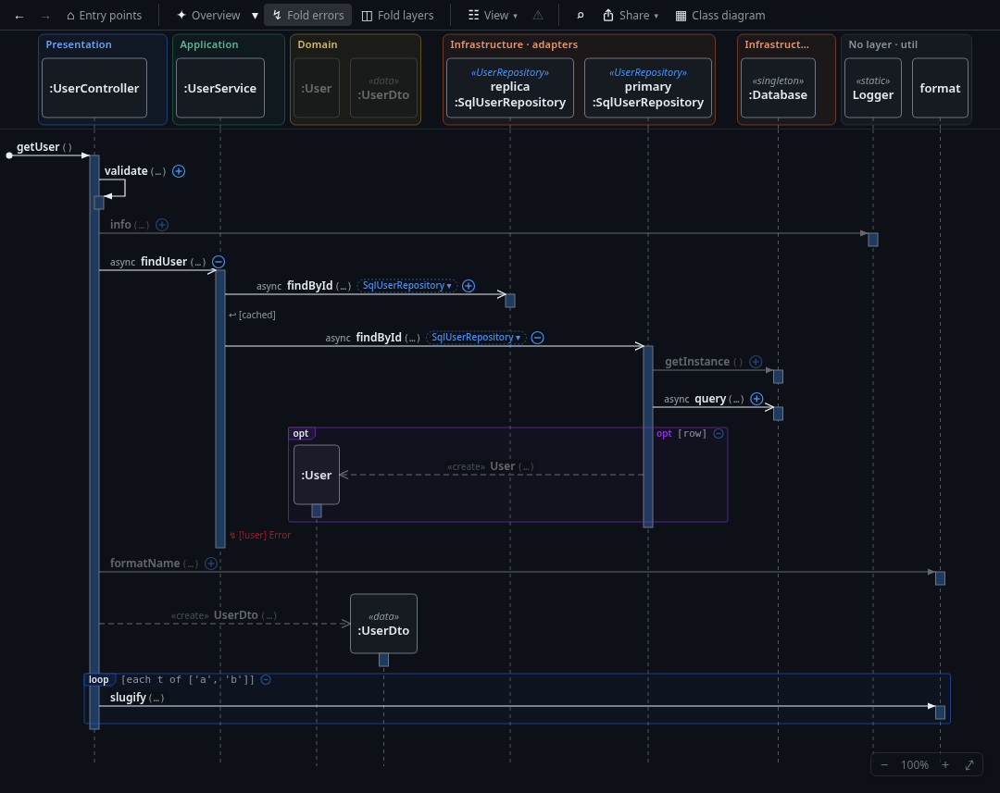
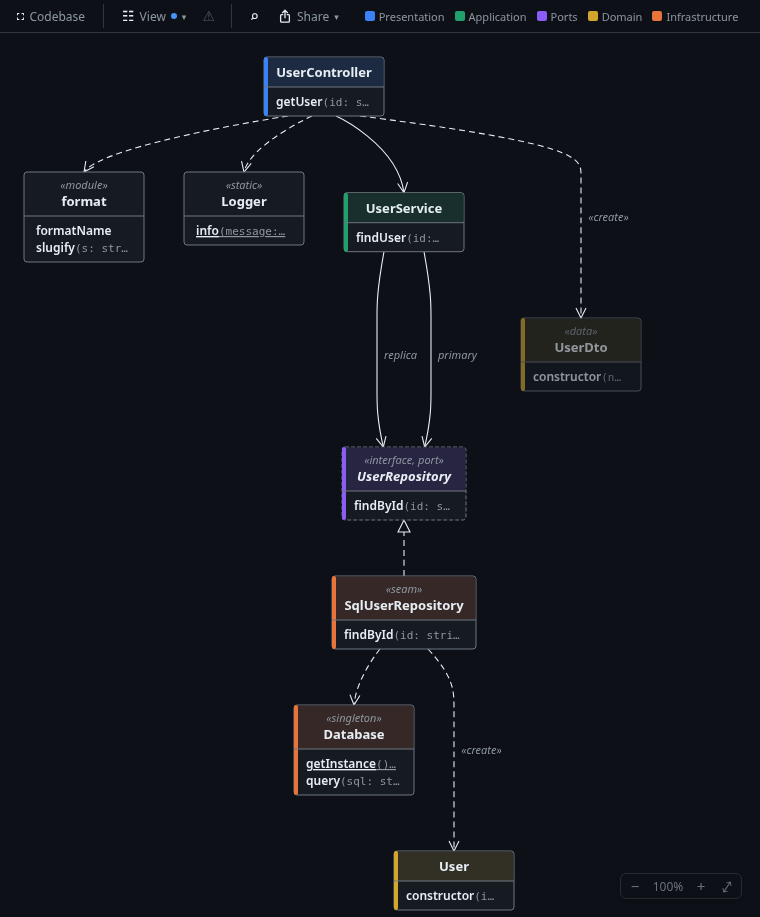

# Seqcall

**See how your code behaves.** Seqcall draws an interactive sequence diagram of the method under
your cursor, together with a live class diagram of the classes taking part. Open the calls that
matter and click any element to jump to the code.

Works with **TypeScript / JavaScript**, **C#** and **PHP** (Laravel and plain PHP 8).

## Getting started

1. Open a project and a source file.
2. Put the cursor inside a function or method.
3. Press **Ctrl+Alt+U**, or right-click and choose **Show Sequence Diagram**.

Or run **Seqcall: Show Entry Points** to start from a route, `main`, a job or a test.

## What you can do

- **Expand step by step.** Use ⊕ / ⊖ on a call to show or hide what happens inside it.
  **✦ Overview** opens the important calls for you: layer crossings, services, repositories and I/O.
- **Jump to the code.** Click a message, participant or frame to reveal the call, class or condition in the editor.
- **See conditions and loops.** `alt`, `opt`, `loop` and `try` frames show when calls are conditional or repeated.
- **Spot I/O.** Small badges (`DB`, `HTTP`, `FILE`, `MQ`, …) mark calls that reach a database, the network or the disk.
- **Check the architecture.** The class diagram groups classes by layer and draws dependency-rule
  violations in red. **⚠** lists design findings such as I/O in a loop or dependency cycles.
- **Find your way.** Find calls and classes (Ctrl+F), show the callers of a method, or list every path from the entry points down to it.
- **See the whole codebase.** **⛶ Codebase** in the class diagram shows every class the entry points reach,
  folder by folder, with the dependencies between folders and the layer violations. Click a folder to open it in place, ⊖ folds it again.
- **Review a branch.** **Seqcall: Review Branch** shows the changed methods, the entry points they affect and issues on the new code.

Right-click messages, participants and classes for more actions. Hidden classes, options and positions are remembered per workspace.

## Commands

| Command | Shortcut |
|---|---|
| Seqcall: Show Sequence Diagram | Ctrl+Alt+U |
| Seqcall: Show Class Diagram | |
| Seqcall: Show Entry Points | |
| Seqcall: Show Codebase Map | |
| Seqcall: Find in Diagram | Ctrl+F (in a diagram) |
| Seqcall: Review Branch | |
| Seqcall: Toggle Follow Cursor | |

## Requirements

- **TypeScript / JavaScript, PHP:** nothing extra.
- **C#:** the .NET 10 runtime and the SDK your solution uses, with packages restored (`dotnet restore`).
  The first diagram takes a few seconds while the solution loads.

## Settings

The most useful ones (search for *Seqcall* in Settings):

| Setting | Default | |
|---|---|---|
| `seqcall.defaultDepth` | `1` | How many levels a new diagram opens |
| `seqcall.showArguments` | off | Arguments in message labels |
| `seqcall.showLibraryCalls` | off | Calls into libraries and the runtime |
| `seqcall.showSideEffects` | on | I/O badges |
| `seqcall.showFragments` | on | `alt` / `opt` / `loop` / `try` frames |

Most of these can also be switched in the diagram's **View ▾** menu.

Layers are recognised from folder and project names (`controllers`, `services`, `domain`,
`App.Infrastructure`, …). To adjust them for your project, add an `.seqcall.json` file at the
project root. The quickest way is the ⚑ on a class: it suggests a layer and writes the rule for you, with *Undo*.

## Feedback

Problems and ideas are welcome as [issues](https://github.com/seqcall/seqcall/issues). Please include the
VS Code version, your OS, the language and the **Seqcall** output (View → Output → Seqcall).
